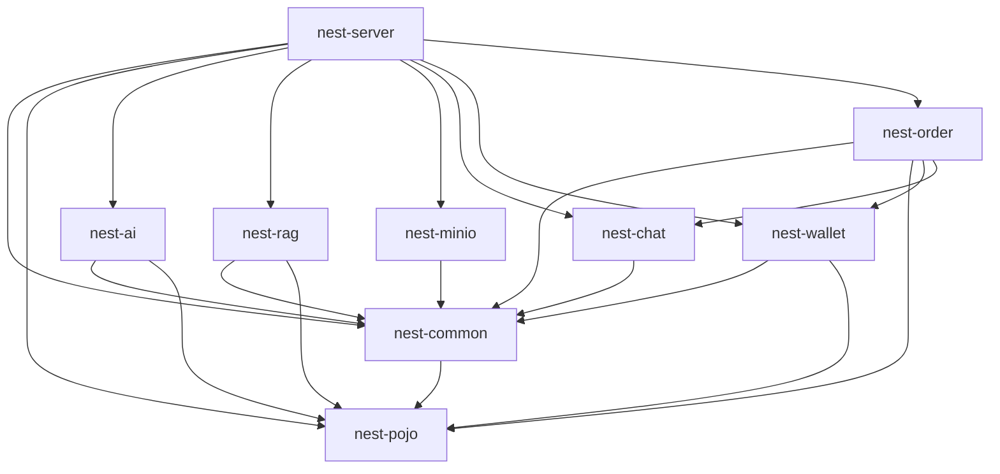

# Nest backend 项目导览

本文按当前源码和各模块 `pom.xml` 记录现状，供后续开发、代码审查和简历项目讲解使用。范围仅为 `backend/`；根工程是 Java 21、Spring Boot 3.4.3 的 Maven 聚合工程，`nest-server` 是启动模块。以下箭头表示 **Maven 直接依赖**，不是运行时调用关系。

## 1. 模块依赖关系

`nest-pojo` 无内部模块依赖。`nest-common` 除通用类型外还放了服务接口，因此依赖 `nest-pojo`。`nest-server` 装配所有模块，并实现聊天入站接口 `MessageListener`；`nest-order` 实现 `nest-wallet` 定义的 `LockedAmountProvider`。模块划分并不等于独立部署：当前仍是一个 Spring Boot 应用。

## 2. 各模块核心类与职责

| 模块 | 核心类 / 接口 | 职责 |
| --- | --- | --- |
| `nest-pojo` | `entity/*`、`dto/*`、`vo/*` | 数据库实体、入参和返回模型；供业务模块共享。 |
| `nest-common` | `Result`、`PageResult`、`PageParam`、`BaseContext`；`BusinessException` 等；`HouseService`、`KnowledgeRetrievalService`、`AiQuotaService` 等接口 | 统一响应、分页、当前用户上下文、异常与跨模块服务契约。`JwtUtil`、`PasswordEncoderUtil`、状态常量也在此模块。 |
| `nest-ai` | `NestAiAgent`、`AiModelConfig`、`AiUserServiceImpl`、`HouseSearchTools`、`KnowledgeTools`、`AiInputGuard`、`AiTraceCollector` | 配置 LangChain4j 流式助手和工具；处理 AI 找房对话、输入防护和轨迹采集。 |
| `nest-rag` | `RagConfiguration`、`KnowledgeIngestionServiceImpl`、`KnowledgeAdminServiceImpl`、`HybridKnowledgeRetrievalService`、`KeywordContentRetriever` | 知识文档入库、管理；向量与关键词检索及结果融合。`RagIngestionRunner` 负责启动时导入内置知识。 |
| `nest-minio` | `MinioConfiguration`、`MinioService` | 对象存储客户端配置与文件上传。 |
| `nest-chat` | `MessageTransport`、`Jsr356Transport`、`NettyTransport`、`ChatConfiguration`；`MessageDispatcher`、`MessageListener`、`PushService` | WebSocket 传输选择、入站消息分发和对外推送接口。业务持久化留在 `nest-server` 的 `ChatServiceImpl`。 |
| `nest-wallet` | `WalletService` / `WalletServiceImpl`、`LockedAmountProvider`、`WalletMapper`、`WalletTransactionMapper` | 钱包懒创建、充值/提现/转账、流水与余额校验；通过接口查询订单占用金额。 |
| `nest-order` | `RentOrderService` / `RentOrderServiceImpl`、`LockedAmountProviderImpl`、`HouseStatusChangedEvent`、`Rent*Task` | 租房确认、押金和租金支付、退租/退款、订单状态流转；定时处理押金超时、租金提醒与退款。 |
| `nest-server` | `NestApplication`、`controller/{admin,user}`、`HouseServiceImpl`、`AppointmentServiceImpl`、`ChatServiceImpl`、`ReviewServiceImpl`、`TenantServiceImpl`、`LandlordServiceImpl`；`GlobalExceptionHandler`、`WebMvcConfiguration` | 应用入口、HTTP API、主要业务编排、MyBatis Mapper、身份鉴权、全局异常与基础设施装配。`ChatMessageListener` 接入聊天入站，`HouseCacheEvictListener` 处理订单引发的缓存失效。 |

## 3. 关键约定

### 异常与接口响应

- Controller 主要返回 `Result<T>`，分页使用 `PageResult`。`Result` 的业务成功码是 `1`，普通错误码是 `0`；指定错误可带 `400`、`401`、`403` 等业务码。
- `nest-server/handler/GlobalExceptionHandler` 捕获 `NotLoginException`、`NoPermissionException`、`BusinessException`、参数校验失败、JSON 解析失败和兜底 `Exception`。业务异常记录 warn，未知异常记录完整 error 并返回通用文案。
- 这些处理器直接返回 `Result`，未通过 `ResponseEntity` 或 `@ResponseStatus` 设置 HTTP 状态；排查客户端行为时要区分响应体 `code` 和 HTTP 状态码。
- `/admin/**` 与 `/user/**` 分别由 JWT 拦截器保护，公开接口在 `WebMvcConfiguration` 中显式排除；新增接口时应核对路径与排除规则。

### 事务与并发

- 多表写入主要在 Service 实现的公开方法上使用 `@Transactional`，如房源、预约、评论、聊天、钱包和租房订单；Controller 和 Mapper 不承担事务编排。
- `WalletServiceImpl.withdraw` 显式使用 `Isolation.READ_COMMITTED`；钱包操作采用行锁、条件扣款及唯一键兜底幂等，订单状态转换也使用条件更新。修改金额或状态逻辑时须保留数据库层并发保护。
- 聊天消息推送在 `ChatServiceImpl` 中注册为事务提交后执行；订单状态变化发布 `HouseStatusChangedEvent`，`HouseCacheEvictListener` 在 `AFTER_COMMIT` 清除房源详情缓存。其他通知调用需逐处核实提交时机，不能假设所有外部副作用都在提交后发生。
- 四个定时任务使用 `@Scheduled` 加 ShedLock，涉及订单押金超时、租金提醒、退款及通知重试。

### 缓存与 Redis

- 房源详情由 `HouseServiceImpl` 手写 Redis 缓存：有正常数据 TTL、空值短 TTL、互斥锁及 TTL 随机扰动；修改房源时清理缓存，订单改变房源状态则通过提交后事件清理。
- `NominatimServiceImpl` 用 Redis 缓存地理编码结果。`RedisChatMemoryStore` 按租客 ID 保存 AI 会话记忆（7 天 TTL）；登录失败限制、JWT 吊销黑名单、AI 配额也使用 Redis，但这些属于状态/限流用途，不是普通查询缓存。
- `HybridKnowledgeRetrievalService` 用 Caffeine 缓存检索结果（最多 500 项，写入后 5 分钟过期）；`AiUserServiceImpl` 的 Caffeine 容器保存每租客并发控制用的信号量。
- `NestApplication` 开启了 Spring Cache，但上述主要缓存路径使用显式 Redis/Caffeine API；不要仅凭 `@EnableCaching` 推断存在 `@Cacheable` 约定。

### 测试风格与构建

- 测试以 JUnit 5、Mockito 和 AssertJ 的服务/行为单测为主；通常构造目标类、模拟 Mapper/外部服务，检查边界、幂等、状态和金额。涉及 `BaseContext` 的测试在 `@AfterEach` 清理 ThreadLocal。
- `WithdrawSnapshotIsolationIT` 使用 Testcontainers MySQL 验证提现并发/隔离，Docker 不可用时按注解跳过。`RagRetrievalEvalTest` 标记 `rag-eval`，默认从 Surefire 排除，按 Maven `rag-eval` profile 单独运行。
- 根 `pom.xml` 配置 Surefire 运行普通单测、Failsafe 在 `mvn verify` 阶段运行 `*IT.java`，JaCoCo 在 `verify` 输出覆盖率报告。当前源码有 22 个测试类文件、131 个 `@Test` 标注；这只是静态计数，不等于已执行通过数或覆盖率。
- 常用验证：在 `backend/` 执行 `mvn test`；需要集成测试和覆盖率时执行 `mvn verify`；RAG 离线评测按 `pom.xml` 中 `rag-eval` profile 单独运行。

## 维护时先看哪里

- 新增业务 API：对应 `controller` → `service` → `mapper`，并检查 DTO/VO、JWT 路径及异常响应。
- 修改订单/资金：先看 `RentOrderServiceImpl`、`WalletServiceImpl` 及相关 Mapper SQL；同时检查幂等键、状态条件更新、事务和相关测试。
- 修改聊天：先看 `nest-chat` 的 `MessageTransport` / `MessageDispatcher`，再看 `nest-server` 的 `ChatMessageListener` / `ChatServiceImpl`。
- 修改 AI/知识库：先看 `NestAiAgent` 的工具接入、`HybridKnowledgeRetrievalService` 的检索与缓存，以及 `RagRetrievalEvalTest` 的评测集。
