<h1 align="center">🏠 Nest 安居租房平台</h1>

<p align="center">
  <strong>多房东 AI 租房平台 · LangChain4j 真实 Agent 找房 · Netty 长连接实时聊天 · 押金锁定与钱包结算闭环</strong>
</p>

<p align="center">
  
  
  
  
  
  
  
  
  
  
  
  
</p>

<p align="center">
  <a href="#-核心亮点">核心亮点</a> ·
  <a href="#-系统架构">系统架构</a> ·
  <a href="#-功能清单">功能清单</a> ·
  <a href="#-快速开始">快速开始</a> ·
  <a href="#-接口一览">接口一览</a> ·
  <a href="#-实机展示">实机展示</a>
</p>


---


## 📖 项目介绍

**Nest（安居）** 是一套**多房东 AI 租房平台**，覆盖**租客微信小程序**与**房东 Web 管理端**双端。后端实现了从「房源发布 → 找房 → 预约看房 → 确认租房 → 缴押金 → 按期缴租 → 申请退租 → 退租结算」的完整撮合闭环，并在两条纵向上做了深度实现：**用真实 Function Calling 做 AI 找房 Agent**，以及**用 Netty 自建长连接做实时聊天**。

项目由三个**相互独立的 Git 仓库**组成，各自独立开发、独立提交：

| 端 | 仓库 | 技术栈 |
|----|------|--------|
| 服务端 | [**Nest_Backend**](https://github.com/kamten7/Nest_Backend)（本仓库） | Spring Boot 3 多模块 · MyBatis · MySQL · Redis · Netty |
| 房东管理端 | [Nest_frontend](https://github.com/kamten7/Nest_frontend) | Vue 3 + TypeScript + Element Plus |
| 租客端 | [Nest_uniapp](https://github.com/kamten7/Nest_uniapp) | uni-app + Vue 3 + Pinia（微信小程序） |

两端共用同一套后端 API，采用 **JWT 双通道认证**：租客请求携带 `authentication` 头，房东请求携带 `token` 头，服务端用两把**独立密钥**分别签发与校验，互不通用——即使租客端 token 泄露，也无法伪造成房东身份。


---


## ✨ 核心亮点

### 🥇 亮点一：LangChain4j 真实 AI Agent 找房

> 不是「拼 prompt → 正则抠参数 → 查库 → 拼回答」的伪 Agent，而是让模型**自己决定调不调工具、调哪个、调几次**。

基于 LangChain4j 的 `AiServices` 声明式 Agent，由 **DeepSeek-V3** 驱动，注册 6 个**只读** `@Tool` 供模型自主调用：

| 工具 | 作用 |
|------|------|
| `searchHouses(city, district, keyword)` | 按城市/区域/关键词搜索房源 |
| `getHouseDetail(houseId)` | 查询单个房源详情（户型、朝向、要求等） |
| `getHouseReviews(houseId, limit)` | 查询房源真实住客评价（评分、内容、时间） |
| `searchRentalKnowledge(question, city, category, topK)` | **Agentic RAG**：检索租房知识库，返回带 `[资料N]` 编号的片段 |
| `findNearby(lat, lng, radiusMeters)` | 按坐标查附近房源 |
| `recommendHouses(budget, city, preferences, count)` | 按预算与偏好智能推荐 |

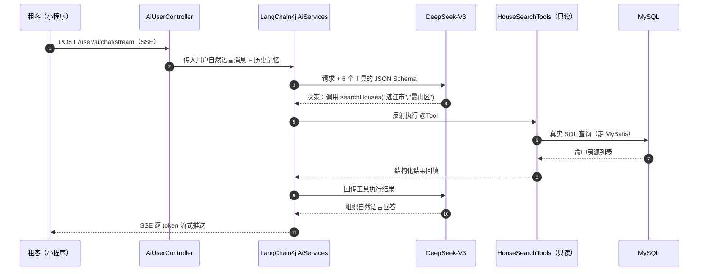

**工程上做了哪些约束**

- **工具零共享状态** —— 每个 `@Tool` 都是无实例可变状态的纯查询方法，天然并发安全，无需加锁。
- **只读工具集** —— 工具层只暴露查询，模型能力再强也无法通过工具链改写数据。
- **写操作人为闸门** —— 预约看房、收藏这类写操作**不开放给模型**，一律由前端弹出确认后走正常 REST 接口，AI 不越权。
- **防幻觉护栏** —— System Prompt 明确约束「不得捏造不存在的房源」「不得泄露房东联系方式」，并要求回答必须基于工具返回的真实数据。
- **记忆持久化** —— 多轮对话记忆落在 Redis，配套 `GET /user/ai/memory`（查看）与 `DELETE /user/ai/memory`（清空）便于调试与会话重置。

> 关键代码：`nest-ai/src/main/java/com/nest/ai/tools/HouseSearchTools.java`、`nest-ai/src/main/java/com/nest/ai/service/impl/AiUserServiceImpl.java`

#### 亮点一补充：Agentic RAG（知识库检索）

押金、退租、合同、费用、流程这类问题不该让模型自由发挥。`nest-rag` 提供一条**按需触发**的知识链路：

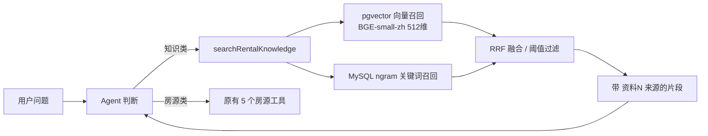

- **文档入库**：12 篇 Markdown（流程/押金/缴租/费用/合同/预约/纠纷/防诈/湛江区域/合租/FAQ）→ 按标题与段落切 450 字、重叠 60，得到 16 个 chunk → 本地 BGE-small-zh 嵌入 → pgvector（HNSW）+ MySQL 分块表；内容 SHA-256 幂等，支持 reindex。
- **混合检索**：向量召回 + MySQL `FULLTEXT ... WITH PARSER ngram` 关键词召回，RRF 融合后按城市/分类过滤。
- **可引用**：工具返回 `[资料1] 《押金与退租规则》…`，System Prompt 要求回答逐条标注来源；没有资料时明确说“暂无依据”。
- **可降级**：pgvector 不可用时 RAG 工具返回“知识库暂不可用”，找房与聊天不受影响；`nest.rag.enabled=false` 可整体关闭。
- **可调试**：`GET /user/ai/knowledge/search?q=押金能退吗` 返回命中片段与分数；管理端 `POST /admin/knowledge/search` 同款。
- **可评测**：25 条 golden set（20 可回答 / 5 不可回答），vector-only **hit@1 0.900、hit@3 0.950、MRR 0.917**；复现：`mvn -Prag-eval -Dtest=RagRetrievalEvalTest -Dsurefire.failIfNoSpecifiedTests=false test`。
- **写入接口**：`POST /admin/knowledge/documents`（Markdown/TXT 上传）、`POST /admin/knowledge/documents/{id}/reindex`、`DELETE /admin/knowledge/documents/{id}`。

> 关键代码：`nest-rag/src/main/java/com/nest/rag/`（入库 / 检索 / RRF）、`nest-ai/src/main/java/com/nest/ai/tools/KnowledgeTools.java`、`db/schema.sql`、`db/postgres/01_rag.sql`。

---

### 🥈 亮点二：Netty 自建长连接 + 传输层可插拔

> 聊天模块把**业务逻辑**与**传输实现**彻底解耦，默认跑 Netty，改一行配置即可切回 JSR-356。

`nest-chat` 采用**三段式 SPI** 设计，业务侧只依赖抽象，不感知底层是 Netty 还是 Servlet 容器：

| 抽象 | 职责 |
|------|------|
| `MessageTransport` | 传输层接口：连接的建立、发送、关闭 |
| `MessageDispatcher` | 入站路由：把收到的消息分发到对应业务监听器 |
| `MessageListener` | 业务 SPI：由业务模块实现「收到消息后做什么」 |

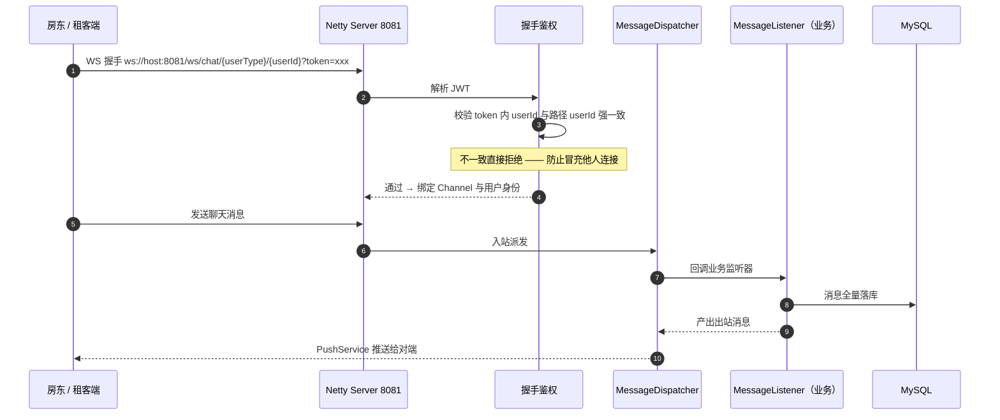

**做了哪些实际能力**

- **握手即鉴权** —— 在 WebSocket 握手阶段完成 JWT 解析，并把 token 中的 `userId` 与连接路径上的 `userId` **强制比对**，杜绝「用 A 的 token 连 B 的通道」这类冒充。
- **一行切传输层** —— `nest.websocket.implementation: netty | jsr356`，业务代码零改动。
- **消息可靠投递** —— 消息**全量落库**；支持离线消息拉取补齐、已读回执、输入中状态。
- **统一出站出口** —— 所有推送收敛到 `PushService`，避免业务代码里散落 Channel 操作。
- **独立端口** —— Netty 监听 `8081`，与 HTTP `8080` 分离，互不影响。

> 关键代码：`nest-chat/src/main/java/com/nest/chat/{netty,jsr356,transport,core,push}/`

---

### 🥉 亮点三：押金锁定 + 钱包双向记账

- **押金锁定机制** —— 押金收到后**留在房东钱包内，但租期内不可提现**。可提现额度 = `余额 − 名下所有在租订单押金之和`，退租结算后自动释放。
- **双向记账** —— 一次资金转移生成**两笔流水**（房东 / 租客），两笔流水的 `peer` 字段互指、共用同一个 `biz_no`，同一事务内写入，保证账实一致、可追溯。
- **防并发超扣** —— 余额扣减走**单条条件 UPDATE**（`... SET balance = balance - ? WHERE balance >= ?`），由数据库行锁保证原子性，从根上杜绝并发场景下的余额超额扣减，无需应用层分布式锁。
- **退租结算兜底** —— 租客申请退租后房东可扣款作为赔偿，剩余押金退回租客；若房东超过 **7 天**未结算，定时任务自动全额退还，防止押金被长期占用。

### 🗺️ 亮点四：零成本地图找房

- 采用 **OpenStreetMap + Nominatim** 免费方案，地址与经纬度互转带 **Redis 缓存 + 限速**，不依赖任何付费地图 Key。
- 地图视野检索先按**外接矩形**做粗筛（走索引），再用 **Haversine 公式**精排真实距离，避免全表算距离。

### 🧩 亮点五：多模块单向依赖 + SPI 反向解耦

- **9 个 Maven 模块**严格单向依赖，任何模块都不回指上层，从架构上杜绝循环依赖。
- 跨模块的「反向」需求（如**钱包需要知道业务侧锁定了多少钱**）通过 **SPI** 解决：**接口声明在钱包侧、实现放在订单侧**，钱包用 `@Autowired(required = false)` 字段注入可选依赖。既不成环，也保证钱包可脱离订单独立编译与单测。

### 🔐 亮点六：零真实凭据的仓库

- 所有敏感配置（数据库口令、JWT 密钥、AI Key、微信凭证）只存在于本地 `application-dev.yml`，该文件已 `.gitignore`。
- 仓库内只提供 `*-example.yml` **模板文件**，全部使用占位符，并在注释里逐项说明「用途 / 是否必改 / 改完要同步哪里」，使用者复制模板 → 填值 → 删除模板即可跑通。


---


## 🧱 系统架构

### 模块依赖

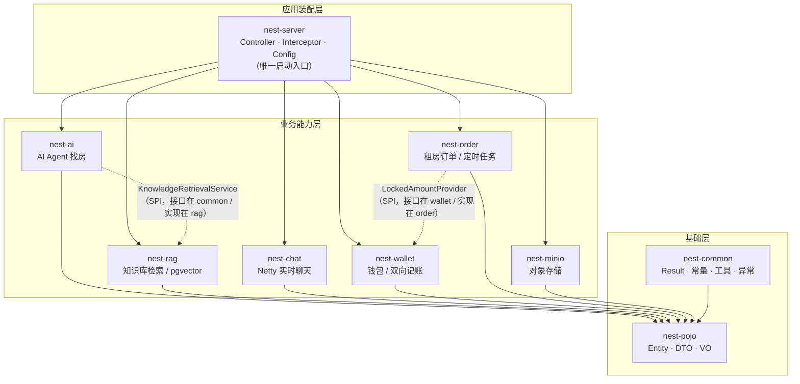

**依赖方向严格单向**：`nest-common` → `nest-pojo` → 各业务模块 → `nest-server`。

- `nest-ai` / `nest-rag` / `nest-minio` / `nest-chat` 只放**配置与服务**，Controller 一律收口在 `nest-server`；
- `nest-wallet` / `nest-order` 则自带 Mapper / Service / Controller，是**自包含的业务模块**；
- 跨模块的反向需求统一通过 SPI 化解（`KnowledgeRetrievalService`、`LockedAmountProvider`、`MessageTransport`），架构上仍无环。

### 技术栈

| 类别 | 技术 | 说明 |
|------|------|------|
| 核心框架 | Spring Boot 3.4.3 · Java 21 | IoC / 自动配置 / 内嵌 Tomcat |
| 持久层 | MyBatis 3.0.4 · PageHelper 2.1.0 | XML 映射 + 物理分页 |
| 数据库 | MySQL 8.0 | **24 张表**；`db/schema.sql` 一键建表，`db/data.sql` 演示数据 |
| 连接池 | Druid | 数据源管理 · 连接池监控 |
| 缓存 | Redis 7 | 地理编码缓存、AI 对话记忆持久化 |
| 向量库 | **pgvector（PostgreSQL 16）** | 知识库向量检索；HNSW 索引，512 维 |
| 对象存储 | MinIO | 房源图片 / 用户头像，双 bucket 分存 |
| 认证 | JJWT 0.12.6 | JWT 双通道，租客与房东独立密钥 + 独立拦截器 |
| AI | LangChain4j 1.18.1 | Function Calling Agent + **Agentic RAG**（本地 BGE-small-zh 中文嵌入） |
| 实时通信 | Netty 4.1.118 | 聊天长连接，握手阶段完成 JWT 鉴权 |
| 参数校验 | Jakarta Validation | DTO 注解 + 全局异常统一处理 |
| 接口文档 | SpringDoc OpenAPI 3（Swagger UI） | `http://localhost:8080/swagger-ui/index.html` |
| 地图服务 | OpenStreetMap + Nominatim | 免费方案，Redis 缓存 + 限速 |


---


## 💡 功能清单

### 房东管理端（Web）

| 模块 | 能力 |
|------|------|
| 房源管理 | 发布 / 编辑 / 上下架房源，地图选点定位，多图上传（MinIO） |
| 预约管理 | 查看租客预约，确认 / 完成 / 取消看房 |
| 租房订单 | 确认租房、查看在租订单、查看缴租进度 |
| 钱包 | 余额与**在租锁定押金**分别展示，提现，收支流水 |
| 退租结算 | 审批退租申请，可扣款作为赔偿，剩余押金退回租客 |
| 实时聊天 | 与租客一对一会话（Netty 长连接） |
| 账号 | 登录 / 注册 / 个人资料维护 |

### 租客端（微信小程序）

| 模块 | 能力 |
|------|------|
| 找房 | 关键词搜索、条件筛选、**地图视野找房**、**AI 自然语言找房** |
| 房源详情 | 图片轮播、户型/朝向/配套、房东信息、住客评论 |
| 收藏与评价 | 收藏房源、发布与删除评论、评论点赞 |
| 预约看房 | 发起预约、查看预约进度 |
| 租房下单 | 基于「已看房」的预约确认租房，缴纳押金 |
| 缴租 | 逐月缴租、**提前支付（最多 5 个月）** |
| 退租 | 发起退租申请、查看结算结果 |
| 钱包 | 余额、收支流水、提现 |
| 实时聊天 | 与房东一对一聊天、离线消息补齐、已读回执 |
| AI 助手 | SSE 流式对话，多轮记忆 |

### 平台能力

JWT 双通道认证 · 统一响应结构（`Result` / `PageResult`）· 全局异常处理 · 定时任务（缴租提醒 / 超期自动退押金 / 待缴押金超时回收）· 多级权限拦截


---


## 🔄 核心业务流程

租客从找房到退租的完整链路：

1. **房东发布房源** —— 填写房源信息、地图选点定位、上传多张图片
2. **租客找房** —— 列表搜索 / 地图视野检索 / **AI 自然语言找房**，进入房源详情
3. **预约看房** —— 租客发起预约 → 房东确认 → 线下看房 → 房东标记「已看房」
4. **确认租房** —— 租客基于「已看房」的预约确认租房，后端生成订单并按房源计算租金与押金（押一付一）
5. **缴纳押金** —— 押金进入房东钱包，但**租期内锁定不可提现**
6. **按期缴租** —— 逐月缴租或提前支付（最多 5 个月）；到期前 3 天系统自动提醒
7. **申请退租** —— 租客发起退租，房东结算：可扣款作为赔偿，剩余押金退回租客钱包
8. **超期兜底** —— 若租客申请退租后房东超过 **7 天**未结算，定时任务自动全额退还押金

订单状态流转：

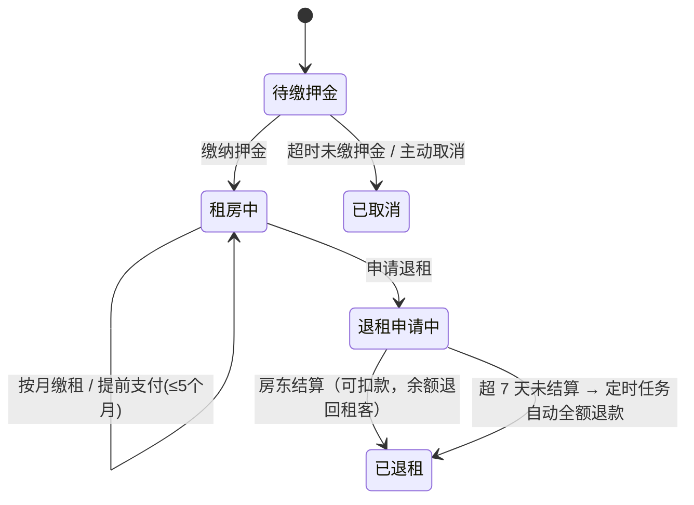

> 状态码：`1 待缴押金` · `2 租房中` · `3 退租申请中` · `4 已退租` · `5 已取消`


---


## 📁 目录结构

```
backend/
├── nest-common/     # 技术底座：Result / PageResult / BaseContext / 常量 / 工具 / 异常
├── nest-pojo/       # 实体 / DTO / VO 统一收口（不随业务模块走）
├── nest-ai/         # AI Agent：模型配置 + 只读 @Tool 工具集 + 对话记忆
├── nest-rag/        # Agentic RAG：文档入库 + pgvector 向量检索 + MySQL ngram 关键词 + RRF 融合
│   ├── src/main/resources/knowledge/  # 12 篇租房知识库 Markdown
│   └── src/main/resources/mapper/     # 知识库 Mapper XML
├── nest-minio/      # 对象存储：MinioClient 配置 + 上传服务（含 bucket 懒创建）
├── nest-chat/       # 聊天：传输层抽象 + Netty 服务端 + 入站派发 + 出站推送
│   └── src/main/java/com/nest/chat/
│       ├── netty/       # Netty 服务端与通道处理器
│       ├── jsr356/      # JSR-356 端点（/ws/chat/{userType}/{userId}）
│       ├── transport/   # 传输层抽象（netty / jsr356 可切换）
│       ├── core/        # MessageDispatcher 入站路由 + MessageListener SPI
│       └── push/        # PushService 统一推送出口
├── nest-wallet/     # 钱包：余额 / 流水 / 双向记账 / 押金锁定 SPI 声明
├── nest-order/      # 租房订单：确认租房 · 缴押金 · 缴租 · 提前支付 · 退租结算
│   └── task/        # 缴租提醒、超期自动退押金、待缴押金超时取消 3 个定时任务
├── nest-server/     # 唯一应用入口：Controller / Service / Mapper / 配置 / 拦截器
│   └── src/main/java/com/nest/
│       ├── controller/   # 租客 /user/** · 房东 /admin/**
│       ├── interceptor/  # JWT 双通道拦截器（user / admin）
│       ├── handler/      # 全局异常处理，统一响应结构
│       └── config/       # WebMvc / CORS / 拦截器注册等横切配置
├── docs/            # 实机截图（README 引用）
├── db/
│   ├── schema.sql   # 唯一 DDL：24 张表（MySQL 8.0）
│   ├── data.sql     # 演示数据（INSERT IGNORE，可重复执行）
│   ├── image/       # 6 张演示房源图，由 minio-init 上传到 MinIO
│   └── postgres/    # pgvector 初始化（PostgreSQL，不是 MySQL）
```


---


## 🚀 快速开始

### 方式 A：Docker 一条命令（推荐；含前端需同级目录有 frontend）

环境要求：Docker Desktop / Docker Engine 24+、Compose v2。

```bash
cp .env.example .env
# 必改：MYSQL_ROOT_PASSWORD / REDIS_PASSWORD / MINIO_ROOT_PASSWORD / NEST_PGVECTOR_PASSWORD
# 注意：MINIO_ROOT_PASSWORD 至少 8 位，否则 MinIO 容器会 exited (1)
# 必改：NEST_JWT_ADMIN_SECRET / NEST_JWT_USER_SECRET（两个不同的 32+ 位随机串）
# 选填：NEST_AI_USER_API_KEY（不填则 AI 找房不可用，其余功能完全正常）

# 只起后端 + 中间件（backend 仓单独 clone 即可）
docker compose --profile full up -d --build

# 需要房东 Web 界面时：把 Nest_frontend clone 到同级目录并命名为 frontend，再加 web profile
# git clone https://github.com/kamten7/Nest_frontend.git frontend
docker compose --profile full --profile web up -d --build
```

启动后：

| 地址 | 说明 |
|------|------|
| `http://localhost` | 房东管理端（仅 `--profile web` 且同级目录有 `frontend` 时） |
| `http://localhost:9090/actuator/health` | 后端健康检查（demo/prod 管理端口；本地 dev 为 8080） |
| `http://localhost:8080/swagger-ui/index.html` | 接口文档（demo profile 开放） |
| `ws://localhost:8081/ws/chat/{userType}/{userId}?token=` | 聊天长连接（Netty，独立端口，可直连） |

> 演示账号：房东 `13800000001 / 123456`（`PLATFORM_ADMIN`，可进「知识库」页）、`13800000002 / 123456`（普通房东）；租客在 demo 下走手机号直登或微信 mock。

首次启动时 MySQL 容器会自动执行 `db/schema.sql` 建好 **24 张表**（业务 20 + 知识库 2 + ai_trace + shedlock），再执行 `db/data.sql` 灌入 2 个房东、1 个租客、3 套房源与评价；知识库 12 篇 Markdown 由 `nest-rag` 在应用启动时自动入库。非 Docker 启动时手动按顺序导入这两个文件即可。
compose 使用 **demo profile**：允许手机号直登与模拟充值，仅限本地演示；公网部署请使用 `prod` profile（见 `application-prod.yml`，`ProdGuard` 会在配置不安全时直接启动失败）。

常用命令：

```bash
docker compose logs -f backend
docker compose --profile full down
docker compose --profile full down -v   # 连数据卷一起删（会清空数据）
```

### 方式 B：本地开发（IDE 调试）

```bash
# 1) 只起中间件：MySQL 3309 / Redis 6381 / MinIO 9012 / pgvector 5433
docker compose up -d

#    若用本机已装的 MySQL（不走 Docker），先手动建库并导入（显式 utf8mb4，避免中文乱码）：
#    mysql -uroot -p -e "CREATE DATABASE IF NOT EXISTS nest_rent DEFAULT CHARACTER SET utf8mb4 COLLATE utf8mb4_0900_ai_ci"
#    mysql -uroot -p --default-character-set=utf8mb4 nest_rent < db/schema.sql
#    mysql -uroot -p --default-character-set=utf8mb4 nest_rent < db/data.sql

# 2) 配置后端（application-dev.yml 已被 gitignore，不会进仓库）
cp nest-server/src/main/resources/application-dev-example.yml \
   nest-server/src/main/resources/application-dev.yml
# 填：nest.datasource.password + nest.jwt.admin-secret-key/user-secret-key

# 3) 构建并启动
mvn clean install -DskipTests
cd nest-server && mvn spring-boot:run

# 4) 另开终端启前端
cd frontend && npm ci && npm run dev   # http://localhost:5173
```

> 需要彻底重建时（⚠️ 会删数据卷）：
>
> ```bash
> docker compose down -v
> docker compose --profile full up -d --build
> ```
>
> 已有库只想补表/补演示数据（`schema.sql` 全是 `CREATE TABLE IF NOT EXISTS`）：
>
> ```bash
> docker exec -i nest_mysql mysql -uroot -p'<你的密码>' nest_rent < db/schema.sql
> docker exec -i nest_mysql mysql -uroot -p'<你的密码>' nest_rent < db/data.sql
> ```

### 第 3 步：跑单测

```bash
mvn test    # 127 个单元测试
```


---

## ⚙️ 配置与部署说明

| 文件 | 谁读取 | 是否进仓库 | 作用 |
|------|--------|------------|------|
| `.env` | Docker Compose | 否 | Compose 变量替换 + 注入容器环境变量（`NEST_*`） |
| `application.yml` | Spring Boot | 是 | 公共配置；敏感值写成 `${NEST_...}` 占位 |
| `application-dev.yml` | Spring Boot（dev） | 否 | 本地 IDE 的数据库口令 / AI Key / 微信凭证 |
| `application-demo.yml` | Spring Boot（demo） | 是 | Docker 演示：允许手机号直登/模拟充值 |
| `application-prod.yml` | Spring Boot（prod） | 是 | 生产收紧：关 mock、关 Swagger、管理端口 9090 |
| `compose.yml` | Docker Compose | 是 | MySQL/Redis/MinIO/pgvector/后端/前端/监控编排 |
| `Dockerfile` | Docker | 是 | 多阶段构建运行镜像，固化 JDK/依赖/启动参数 |

配置链路：`.env` → 容器环境变量 → `application-*.yml` 的 `${NEST_...}` → Spring Bean。

- **只跑 Docker demo**：`.env` + `compose.yml` 足够，可以不要 `application-dev.yml`。
- **用 IDE 跑 dev**：需要 `application-dev.yml`（本地中间件地址、口令、API Key）。
- `application.yml` 不能删：它是端口、MyBatis、Redis、AI、RAG 等公共配置的主入口。
- `compose.yml` 是仓库内**正式编排文件**（不是示例），敏感值从 `.env` 注入；`.env.example` 才是模板。本地若还留着旧的 `docker-compose.yml`，它已被 gitignore，可删除，统一用 `compose.yml`。
- `Dockerfile` 不是必须，但让“换一台机器/上线”不依赖手工装 JDK/Maven，且启动参数、健康检查、非 root 用户都可版本化。

## 🗄️ 数据库脚本

| 文件 | 数据库 | 说明 |
|------|--------|------|
| `db/schema.sql` | **MySQL 8.0** | 唯一 DDL：24 张表，全部 `CREATE TABLE IF NOT EXISTS`；旧库缺 `landlord.role` 会幂等补列 |
| `db/data.sql` | **MySQL 8.0** | 唯一数据文件：2 房东 / 1 租客 / 3 房源 / 评价 / 钱包，`INSERT IGNORE` 可重复执行 |
| `db/image/*.jpg` | **MinIO** | 6 张演示房源图，`minio-init` 上传到 `nest-rent/demo/`，`data.sql` 存 MinIO URL |
| `db/postgres/01_rag.sql` | **PostgreSQL + pgvector** | 向量库初始化（表 + HNSW），**不是 MySQL**，不要导入 MySQL |

- Docker：MySQL 容器首次初始化（数据卷为空）按 `01_schema.sql` → `02_data.sql` 自动执行；`minio-init` 会把 `db/image/` 上传到 MinIO 的 `nest-rent/demo/`。
- 演示图片 URL 默认是 `http://localhost:9012/nest-rent/demo/...`；如果你改了 `NEST_MINIO_PORT`，同步改 `data.sql` 里的 URL 或重新导入。
- 手动：先建库，再 `mysql -uroot -p --default-character-set=utf8mb4 nest_rent < db/schema.sql`、`< db/data.sql`。两个脚本开头都有 `SET NAMES utf8mb4`，避免中文被按 latin1 写入。
- 已有数据卷不会重复执行 init 脚本；需要补表时手动导入 `schema.sql`（幂等）。


---


## 🔌 接口一览

接口按调用方角色划分命名空间，由两个独立的 JWT 拦截器分别守卫：

| 命名空间 | 调用方 | 认证头 |
|----------|--------|--------|
| `/user/**` | 租客端（小程序） | `authentication` |
| `/admin/**` | 房东端（Web） | `token` |

部分核心接口：

| 接口 | 方法 | 说明 |
|------|------|------|
| `/user/ai/chat/stream` | POST | **AI 找房对话（SSE 流式）** |
| `/user/ai/memory` | GET / DELETE | 查看 / 清空 AI 对话记忆 |
| `/user/chat/conversations` | GET | 会话列表 |
| `/user/chat/messages/{conversationId}` | GET | 拉取历史消息（支持离线补齐） |
| `/user/chat/unread` | GET | 未读计数 |
| `/admin/chat/**` | — | 房东侧同名聊天接口 |
| `/user/ai/knowledge/search` | GET | **Agentic RAG 检索调试**（返回片段/来源/分数） |
| `/admin/knowledge/documents` | GET / POST | 知识库文档列表 / 上传（Markdown / TXT） |
| `/admin/knowledge/documents/{id}/reindex` | POST | 重建文档向量索引 |
| `/admin/knowledge/documents/{id}` | DELETE | 删除知识库文档 |
| `/admin/ai/traces` | GET | 最近 AI 轨迹（工具/token/延迟） |
| `/admin/ai/stats` | GET | AI 聚合统计（对话数/成功率/平均延迟/token） |
| `/user/auth/logout` · `/admin/auth/logout` | POST | 登出并把 token 的 jti 写入 Redis 黑名单 |
| `/user/house/list` · `/detail/{id}` · `/map` | GET | 房源列表 / 详情 / 地图检索（公开） |

完整接口文档：启动后访问 `http://localhost:8080/swagger-ui/index.html`。


---


## 📸 实机展示

### 房东管理端（Web）

**🏠 房东端首页** — 房源总览与数据概览

<p align="center">
  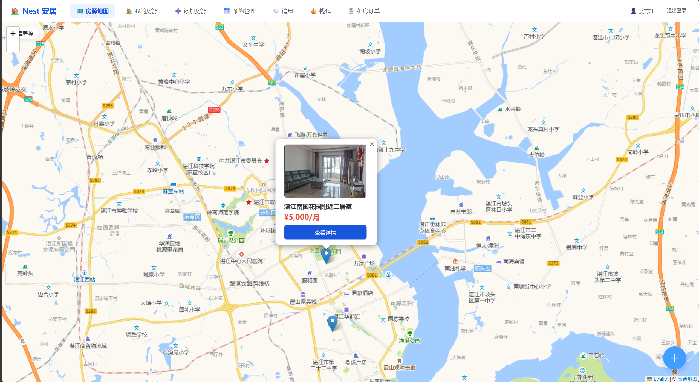
</p>

**📋 房源管理 & ➕ 添加房源** — 房源列表管理 / 信息填写 + 地图选点 + 多图上传

<p align="center">
  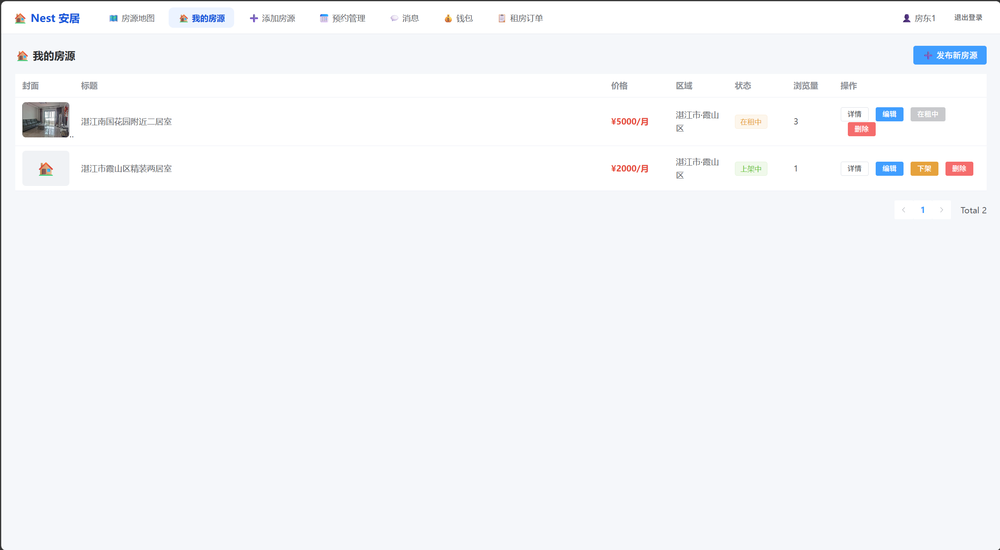
  &nbsp;
  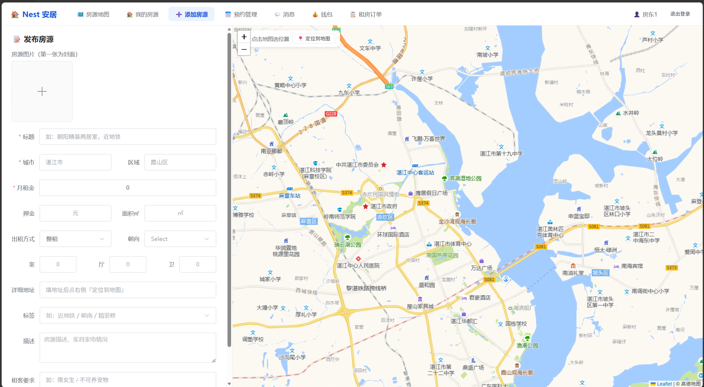
</p>

**📅 预约管理** — 查看并处理租客的看房预约

<p align="center">
  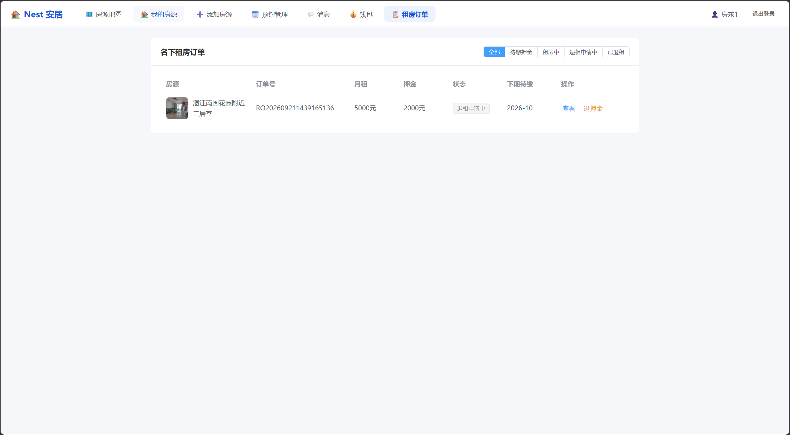
</p>

**💰 钱包** — 在租押金（不可提现）/ 可提现余额 / 收支流水

<p align="center">
  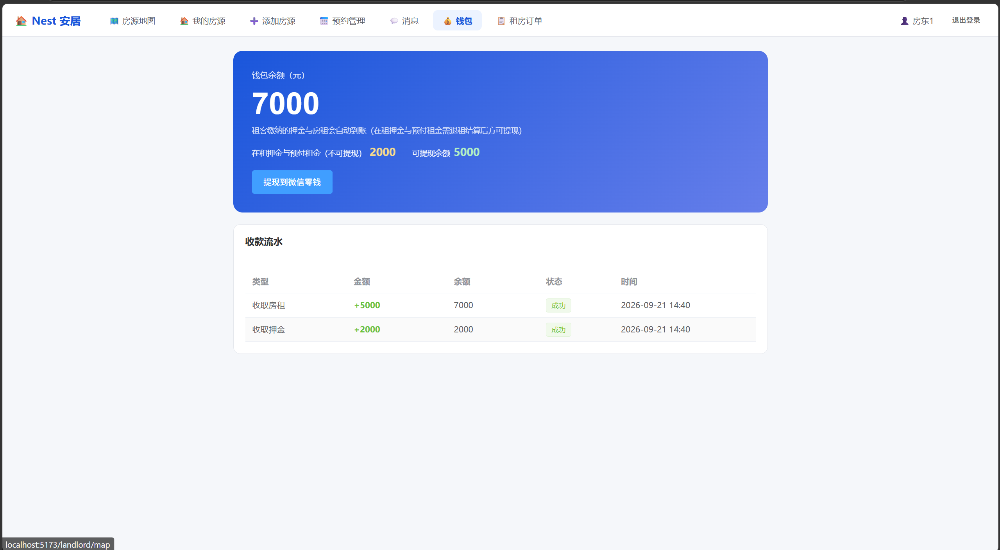
</p>

**💬 聊天 & 👤 个人主页** — 与租客一对一会话 / 房东资料维护

<p align="center">
  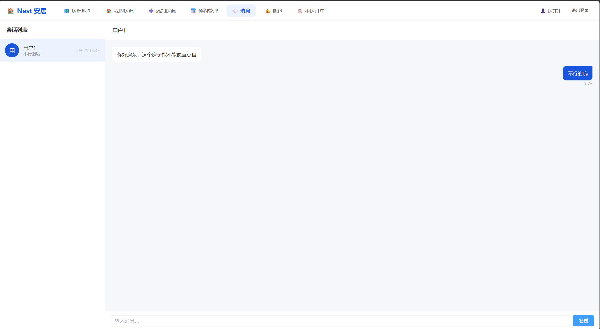
  &nbsp;
  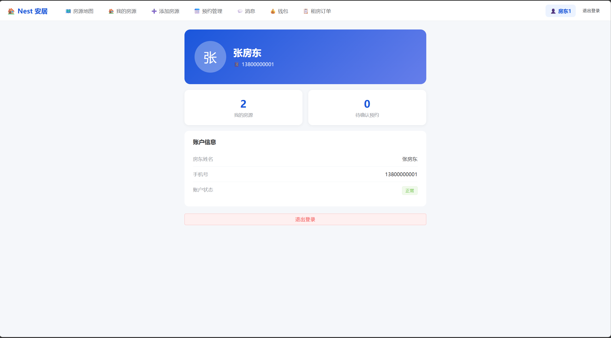
</p>

### 租客端（微信小程序）

**🏠 首页 · 🗺️ 地图找房 · 📋 房源详情**

<p align="center">
  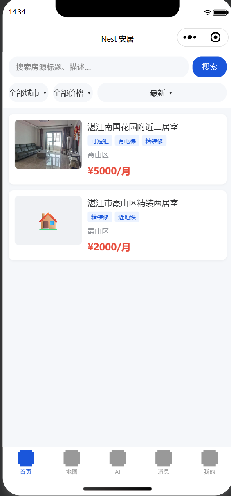
  &nbsp;
  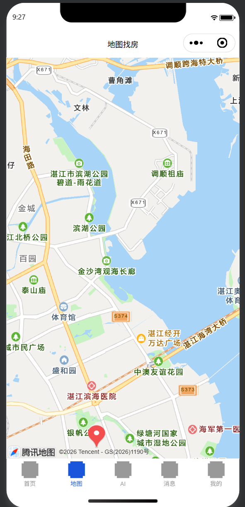
  &nbsp;
  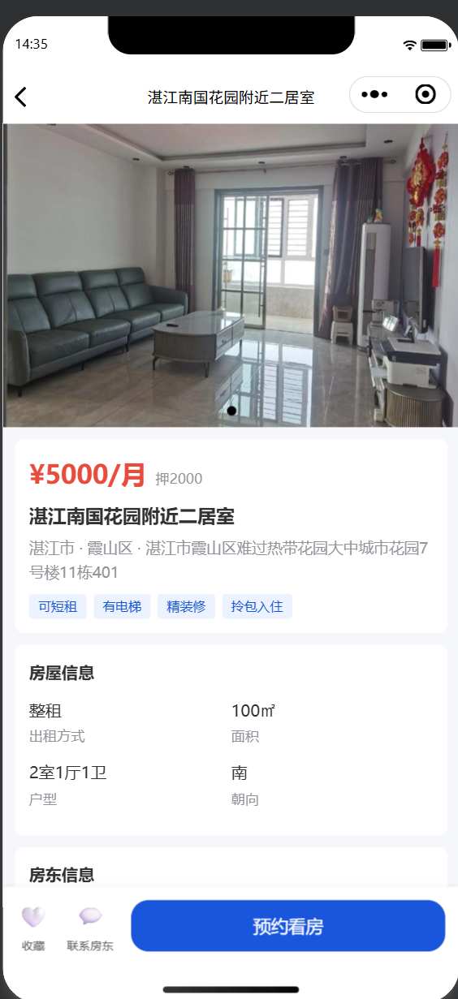
</p>

**🤖 AI 聊天 · 💬 私聊 · ⭐ 评论**

<p align="center">
  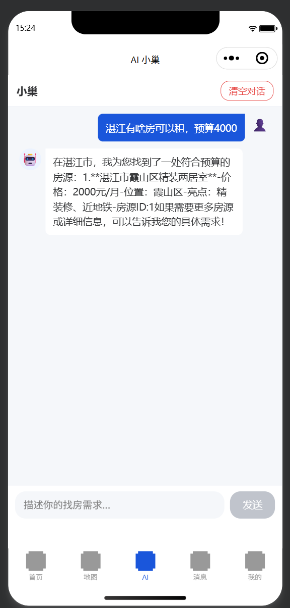
  &nbsp;
  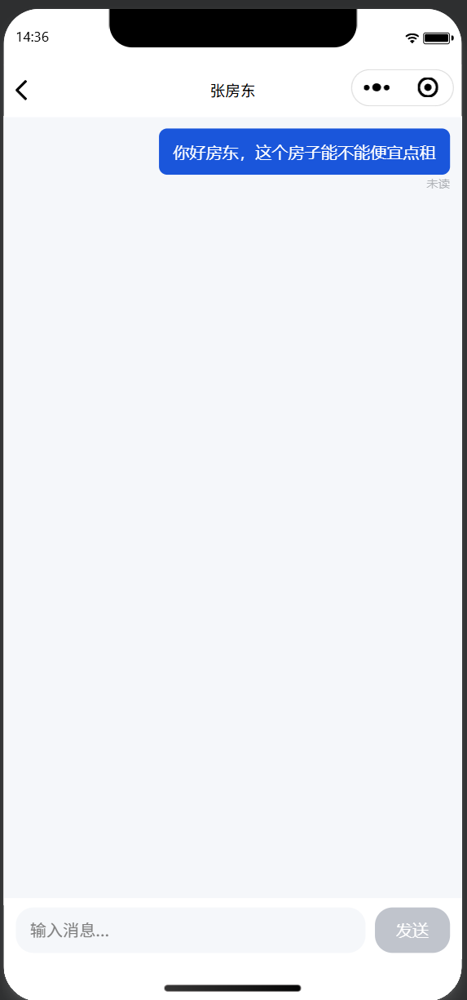
  &nbsp;
  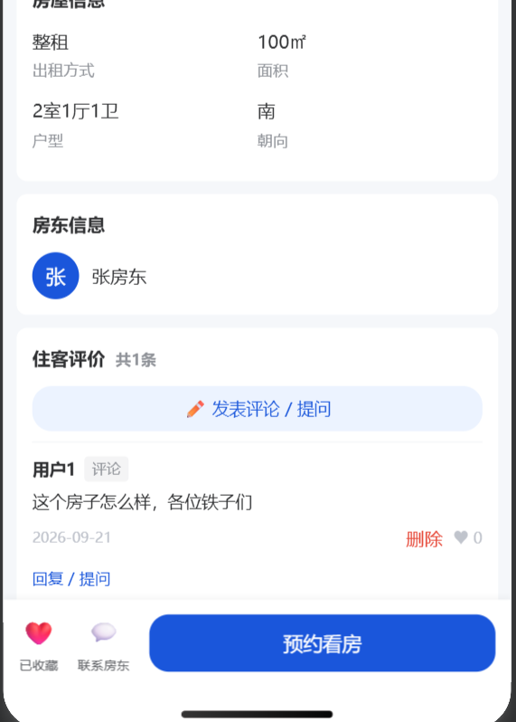
</p>

**📅 预约列表 · 💰 钱包 · 💸 提现**

<p align="center">
  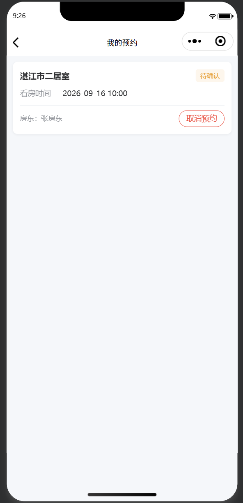
  &nbsp;
  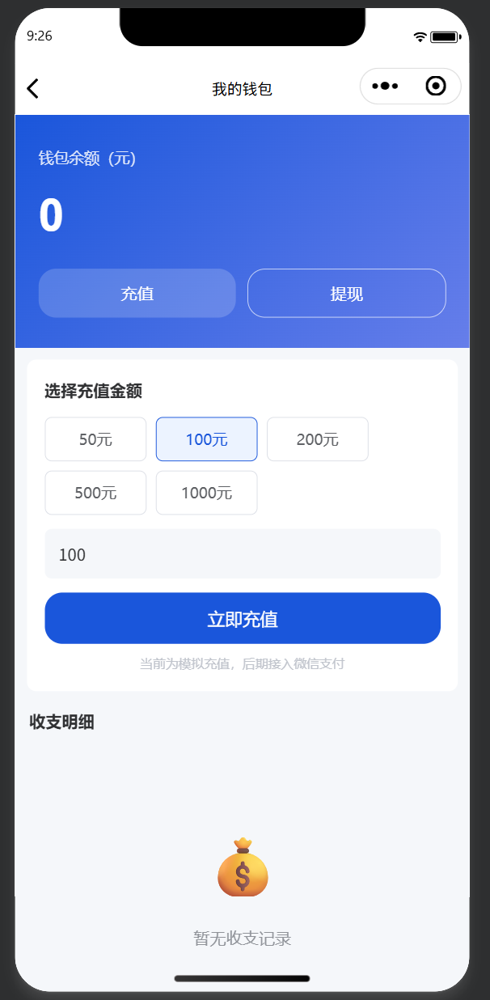
  &nbsp;
  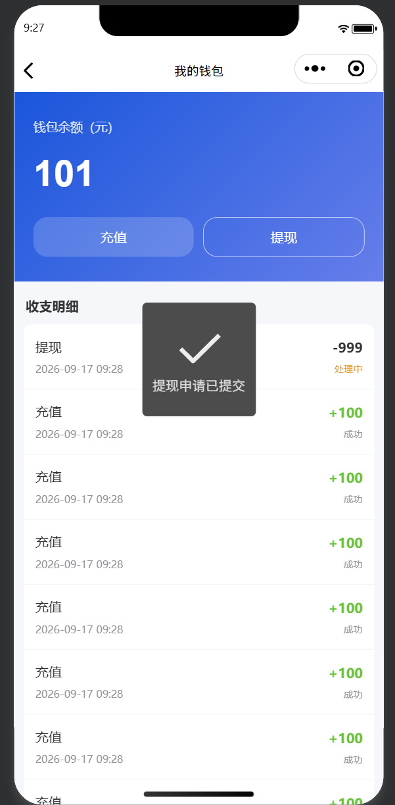
</p>

**👤 个人页面**

<p align="center">
  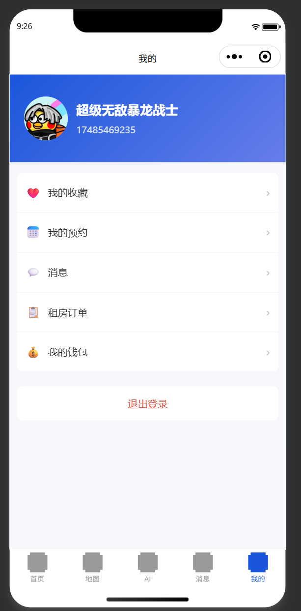
</p>


---


## 🧪 工程质量

| 项目 | 说明 |
|------|------|
| 单元测试 | **127 个**，覆盖钱包锁定/提现、退租退款、分页边界、房源状态流转、RAG 解析/检索工具、AI 输入护栏等核心逻辑 |
| 持续集成 | GitHub Actions：`backend-ci` 跑 `mvn verify`，PR 红灯不合入 |
| 一键部署 | 多阶段 Dockerfile + `compose.yml`（MySQL/Redis/MinIO/后端/前端），`--profile full` 一条命令起全栈 |
| 环境隔离 | `dev` / `demo` / `prod` 三套 profile；`ProdGuard` 在 prod 下强制关闭 mock/模拟充值/手机号直登，并校验 JWT 长度与 CORS 来源 |
| 模块化 | 9 个 Maven 模块单向依赖，无循环依赖 |
| 配置安全 | 敏感配置全部外置到 gitignore 的本地文件，仓库内只有 `.env.example` 与占位符模板 |
| 异常处理 | 全局异常处理器统一收敛，响应结构一致（`Result` / `PageResult`） |
| 边界防护 | 分页参数 clamp、状态流转条件 UPDATE 守卫、删房行级锁防竞态 |
| 安全加固 | 登录失败限流（账号 + IP，Redis）、JWT `jti` 吊销、地图查询最多 200 点 + 半径 clamp、AI 每日配额、输入护栏、CORS 白名单、`ProdGuard` 生产启动校验 |
| 可观测性 | Actuator health/metrics/Prometheus、AI Trace（工具/token/延迟）、`/admin/ai/stats`；`--profile obs` 起 Prometheus + Grafana |
| 多实例 | 4 个定时任务接入 ShedLock，同一任务同一时刻只有一个实例执行 |

---

## 📈 可观测性

- **健康检查**：`GET /actuator/health`（demo/prod 管理端口 9090；dev 为 8080）。
- **Prometheus**：`GET /actuator/prometheus`，含 HTTP QPS/延迟、JVM、`nest_ai_requests_total`、`nest_ai_latency_seconds`。
- **AI Trace**：每次对话异步落 `ai_trace`（工具调用、token、延迟、错误），`GET /admin/ai/traces`、`GET /admin/ai/stats` 查询；不把高基数标签塞进 Prometheus。
- **一键起监控**：`docker compose --profile obs up -d` → Prometheus `9091`、Grafana `3000`（见 `observability/README.md`）。
- **日志**：`logback-spring.xml` 控制台 + 按天滚动文件（100MB/文件、30 天、1GB 上限）。


## 🗺️ 路线图（持续迭代）

- [x] 三端功能闭环 + 127 个单测
- [x] Docker 一键启动 + 三端 CI
- [x] dev / demo / prod 配置分层 + 生产启动守卫
- [x] SQL 建表/数据脚本（`db/schema.sql` + `db/data.sql`）+ Testcontainers 集成测试
- [x] **Agentic RAG**：pgvector + 本地中文嵌入 + 向量/关键词混合检索 + 来源引用 + 12 篇知识库
- [x] AI Trace / 配额 / 输入护栏 / 25 条 golden set 离线评测
- [x] Prometheus + Grafana（`--profile obs`）
- [x] 登录限流、JWT 吊销、地图查询上限、ShedLock
- [ ] JMeter 压测报告 / Grafana dashboard JSON / AI Ops 前端页 / hybrid 检索评测


---


## 📄 License

MIT © [kamten7](https://github.com/kamten7)
